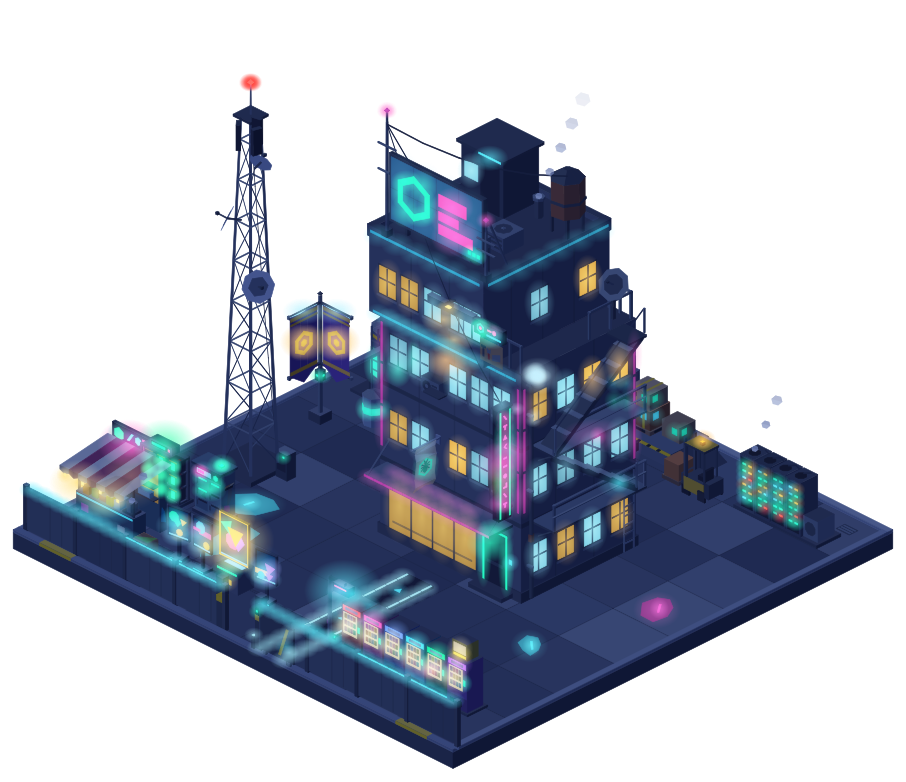
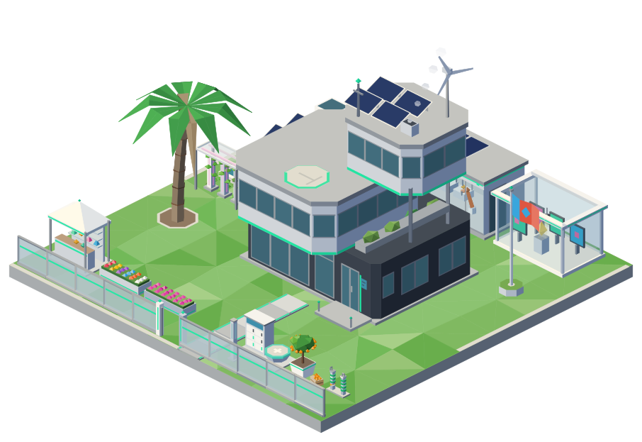
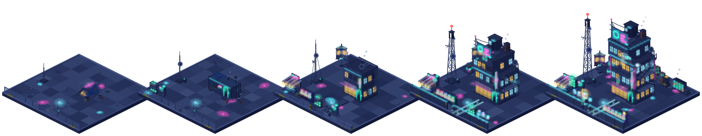
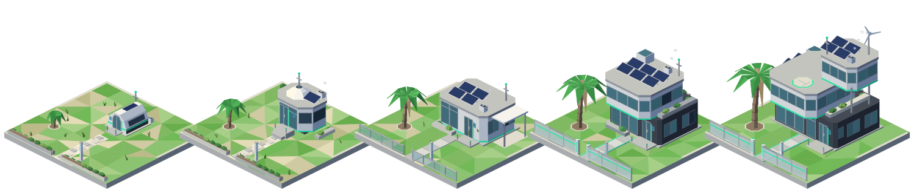
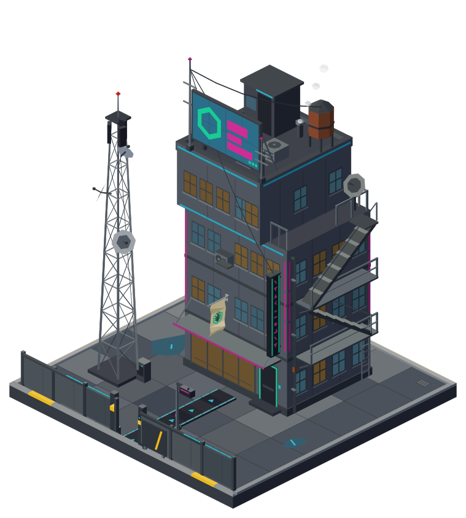
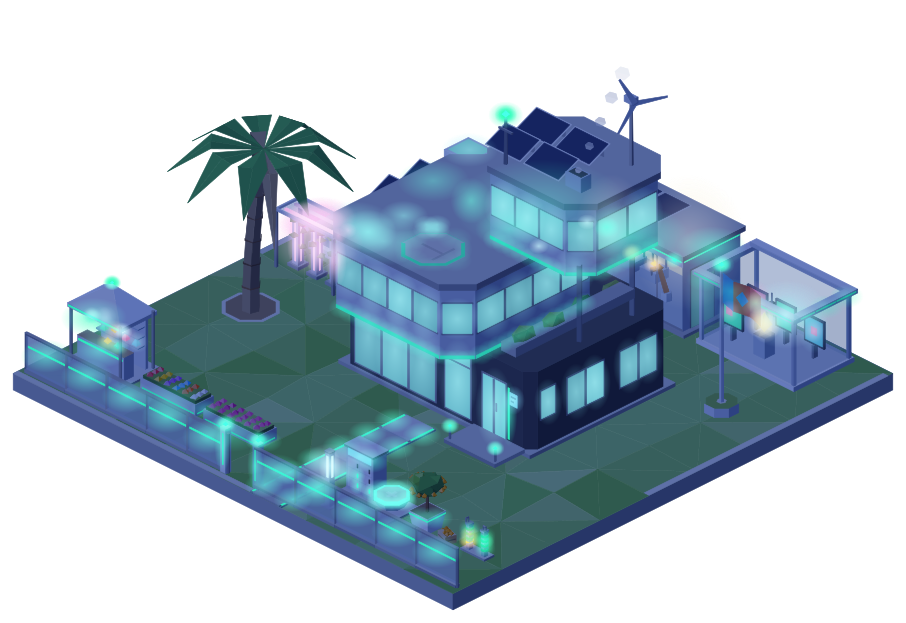

# Neo World

**A living, hand-coded isometric world that grows from activity on Neo N3 and Neo X.**

Every wallet already has a home. Its history decides what that home looks like.

 

Left: the Mainland (Neo N3) at night. Right: the Coast (Neo X) by day.

---

## The idea

Blockchains are full of stories that nobody can see. Neo World turns them into a place.

Look up any address and you find a plot with a home on it. Stay active and the home grows, from a tent to a tower. Hold for years and your landmark rises taller. Vote, build, collect, and the plot shows it. Go quiet and the plot goes dark, then lights up again when you return.

All of those plots together make a city that grows outward, week by week, from the oldest wallets at its centre.

## Two lands, two futures

**The Mainland is Neo N3:** a weathered neon city of concrete, cables and signs, alive wherever its residents are. Homes grow from a squatter's tent to a container shack, a walk-up, a tower house and finally a neon tower, while an antenna mast grows beside them into a lattice tower with a blinking light. Wallets from the Antshares days fly a heritage flag.

**The Coast is Neo X:** clean, bright and modern. Homes grow from a capsule tent to a pod, a villa, a house and a hub with solar roofs and a turbine, on landscaped lawns behind glass balustrades.

A bridge joins the two, and the world follows a real 24-hour day: neon and windows switch on as night falls.

 

## What makes it different

| | |
| --- | --- |
| **Earned, not bought** | Size, age and status come from real on-chain history. Money can buy decoration, never rank. |
| **Drawn entirely in code** | No sprites, no asset packs. Every building, mast and sign is generated, so the world can grow without limit in one consistent style. |
| **Verifiable** | The same input always produces the same plot. Anyone can re-render a plot from its public data and check it. |
| **Privacy first** | Balances stay hidden until a wallet's owner claims their plot, and owners can hide them again at any time. |
| **Honest about time** | Long-held, long-active wallets show it. Quiet plots fade a little; nothing earned is ever taken away. |

## What lives in this repository

This is the open-source core of Neo World: the parts that are useful to anyone building on Neo.

- **The engine** draws the low-poly world: geometry, lighting, day and night, and rendering.
- **A reference art pack** with a deliberately plain look, so everything works out of the box.
- **The asset lab**, the review tool where every object can be watched growing from its first stage to its last, by day and night, as it decays, from any angle and at every zoom level.

More open pieces will follow: the event collector for Neo N3 and Neo X, wallet signature verification, and the plot data format.

## Where it stands

Neo World is in its earliest phase: the visual direction is set and the first objects are built.

1. **Style and assets** (now): the look of both lands, and the objects that make a plot
2. **Living Mirror**: look up any address, claim your plot, watch the world change every week
3. **The City**: districts, project landmarks, live events
4. **Living Economy**: seasons, festivals, showcase lots

## License

Apache-2.0. See [LICENSE](LICENSE).
