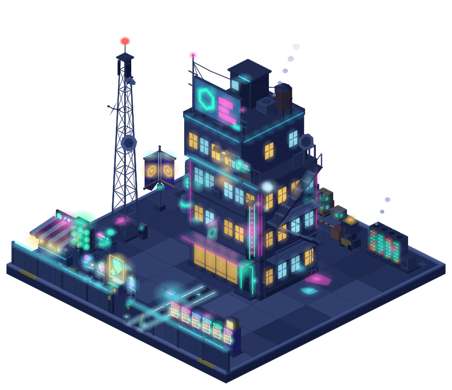
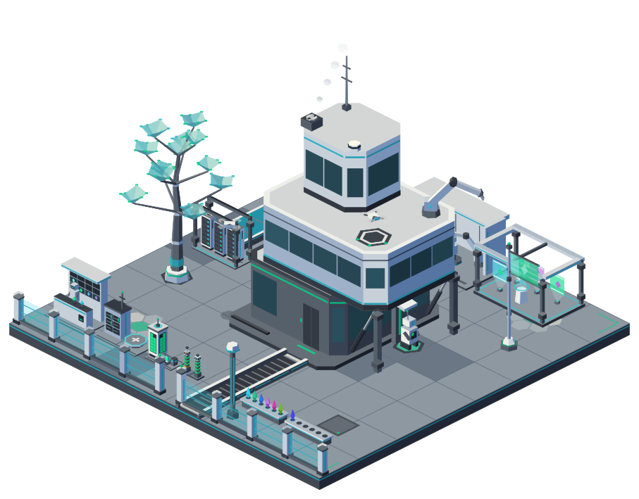
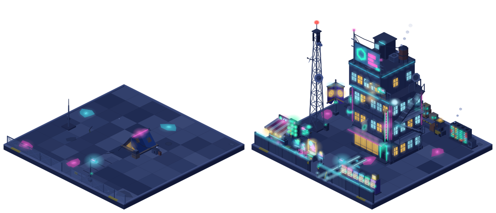
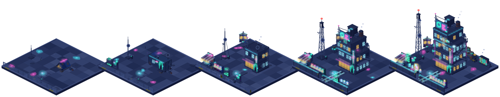
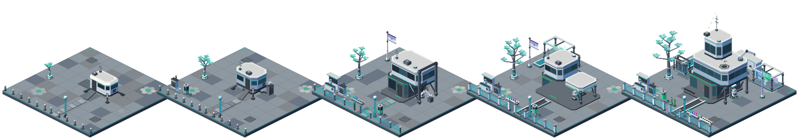
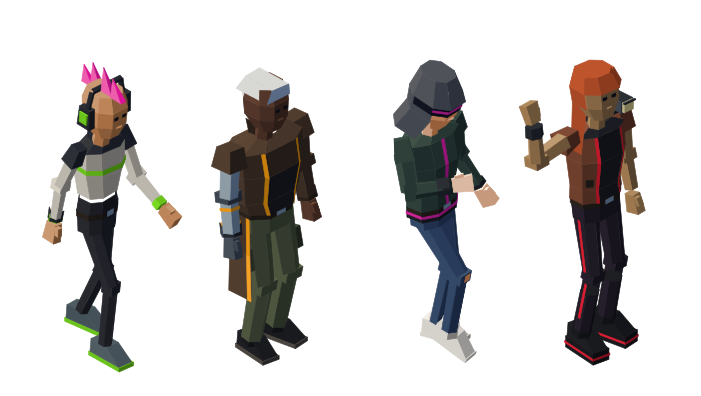
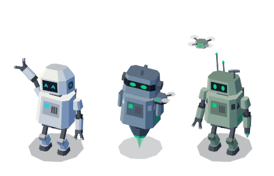

<div align="center">

# Mempolis

**A living city that grows out of real blockchain activity, drawn entirely in code.**

Every wallet has a home waiting. Its on-chain history decides what that home looks like.

**[mempolis.com](https://mempolis.com)**

 

<sub>Left: the Sprawl on Neo N3, at night. Right: the Array on Neo X, by day.</sub>

</div>

---

## The idea

Blockchains are full of stories that nobody can see. Mempolis turns them into a place.

Look up any address and see the home its history would build. Claim it, and it moves into the city. Stay active and the home grows from a tent into a landmark. Hold for years and your mast rises higher. Vote, build, collect, and the plot shows it. Go quiet and the lights dim, then come back on when you return.

The city only holds homes their owners chose to place, so it grows street by street. The oldest wallets settle in the old town at its centre, and the projects people use stand among them as landmarks.

<div align="center">

<br><sub>A newcomer's lot next to a veteran's. Every object on the right was earned on chain.</sub>
</div>

## One city per chain

Each chain gets its own city with its own look, built on the same engine. The first two:

**The Sprawl, on Neo N3:** a weathered neon city of concrete, cables and signs, alive wherever its residents are. Homes grow from a squatter's tent to a container shack, an apartment block, a tower house and a neon tower, with an antenna mast rising beside them.

<div align="center">

</div>

**The Array, on Neo X:** a robotic district on an offshore platform, built for the AI agents Neo X is made for. Homes grow from a sleep capsule to a pod, a servo house, an agent bay and a machine hub, on steel decks behind force-field fences.

<div align="center">

</div>

The world follows a real 24-hour day: neon and windows switch on as night falls where you are.

## The people who live there

Every resident gets a character to walk their streets: a street punk in the Sprawl, a robot companion in the Array. Activity unlocks rarer looks, and like everything else they are drawn and animated in code.

<div align="center">
 
</div>

## What makes it different

| | |
| --- | --- |
| **Earned, not bought** | Size, age and status come from real on-chain history. Money can buy style, never rank. |
| **Drawn entirely in code** | No sprites, no asset packs. Every building, mast and character is generated, so the world can grow without limit in one consistent style. |
| **Verifiable** | The same input always draws the same plot. Anyone can re-render a plot from public data and check it. |
| **Honest about time** | Long-held, long-active wallets show it. Quiet plots fade a little; nothing earned is ever taken away. |

## What is in this repository

This is the open core of Mempolis: the parts that are useful to anyone who wants to draw worlds in code or build on Neo.

| Package | What it does |
| --- | --- |
| [`engine`](packages/engine) | Low-poly isometric geometry, lighting, day and night, animation and SVG rendering |
| [`reference-art`](packages/reference-art) | A deliberately plain art pack, so everything works out of the box |
| [`asset-lab`](apps/asset-lab) | The review tool: watch any object grow, decay and animate, by day and night, from every angle |
| [`n3-client`](packages/n3-client) | A small, browser-safe client for Neo N3 wallet history |

The city's own art, rules and app stay closed for now. To open the asset lab:

```sh
pnpm install
pnpm lab
```

## Where it stands

The look of the first two cities is set, and the homes, residents and live preview are built. Next:

1. **Founders' beta:** the first residents sign an on-chain guestbook and are remembered for it.
2. **Claim your plot:** claiming mints a deed tied to your wallet.
3. **Earn your rewards:** activity unlocks outfits, pets, bikes, cars and drones for your resident.
4. **The city:** districts fill up, and projects get landmarks.
5. **Agents move in:** AI agents become residents you can watch at work.
6. **Living economy:** seasons, festivals and markets.

## License

Apache-2.0. See [LICENSE](LICENSE) and [NOTICE](NOTICE).

<div align="center">
<sub><a href="https://mempolis.com">mempolis.com</a> · Made by <a href="https://smartargs.com">SmartArgs</a>.</sub>
</div>
